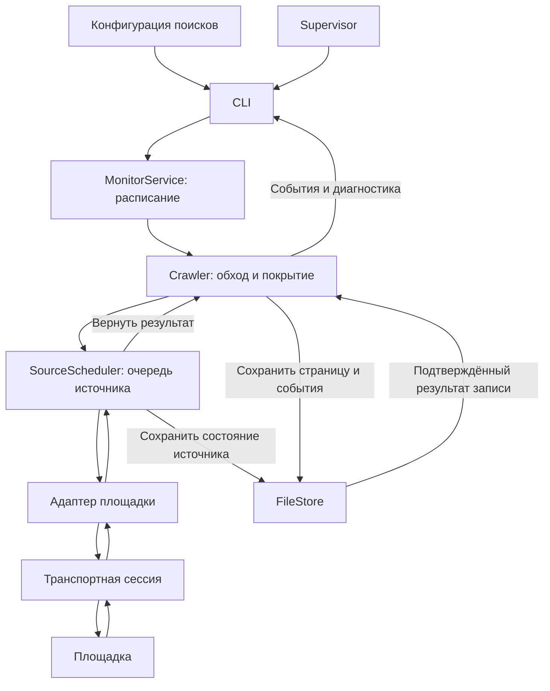

# CarRadar: возможности, архитектура и ограничения

**Срез на 12 октября 2026 года.** Документ предназначен для обсуждения развития продукта. Он описывает фактический код и результаты проверок, отдельно отмечает архитектурные намерения. Новые источники, интерфейс и сервисы при его подготовке не реализовывались.

## 1. Что представляет собой система сейчас

CarRadar — работающий постоянный сборщик автомобильных объявлений Авито. Он получает выдачу, сохраняет наблюдения, повторяет опрос по расписанию, сравнивает записи и восстанавливает состояние после перезапуска. Управление осуществляется через команды и JSON-конфигурацию.

Уже есть минимальное ядро мониторинга, одна реальная интеграция, файловое хранилище, события, диагностика и управление процессом. Для превращения этого ядра в пользовательское приложение ещё нужны продуктовые решения и дополнительные компоненты.

**Текущий монитор остановлен.** Чистый тест интервала 300 секунд завершён 12 октября, 20:01:32–20:26:32 МСК, за 1500.039 секунды. Система остановлена по duration, exit0, attempts1, childPid=null; writer/supervisor locks отсутствуют. Сохранены 1132 объявления, 0 событий и 4 обогащённые записи. Успешных обходов выдачи 4/5, циклов без ошибки каталога или карточки 2/5. Страниц 30, наблюдений 1432, native HTTP 42. HTTP 429: каталог 1, карточки 2; HTTP 403 не наблюдался. Gaps 1, resumeCursor=null, requiresFullScan=true. Прежние1132/3 и state/run/exports с config240 сохранены в before-five-minute-test-2026-10-12-200125; более ранние прогоны также остаются в архивах. Очистка выполнена отдельно для сопоставимых проб, обычный перезапуск состояние сохраняет.

Рабочий поиск: **Волгоградская область, все марки, до 150 000 ₽**. ВАЗ входит в выдачу вместе с остальными марками. Собственной оценки «суперинтересности», выгодности покупки и отдельного правила «только АвтоВАЗ» сейчас нет.

## 2. Что уже умеем

| Возможность | Как реализована | Практическая граница |
| --- | --- | --- |
| Постоянный мониторинг | Циклы до остановки, интервалы и восстановление | Компьютер должен работать; системного автозапуска нет |
| Несколько поисков | Собственное состояние и расписание каждого запроса | Запросы одного источника разделяют его очередь и паузу |
| Фильтры площадки | Готовый URL поиска в конфигурации | Своего конструктора фильтров и их универсального языка нет |
| Пауза поиска | `enabled=false`, применение при перезапуске | Горячего редактирования и интерактивного управления нет |
| Объединение одинаковых поисков | Одинаковые `source + точный URL` собираются один раз; ID становятся aliases | Семантически похожие, но разные URL автоматически не объединяются |
| Обход страниц | Начальный проход, опрос верхнего окна, периодическая сверка и догон | Проверяется доступная выдача; ограничения сайта остаются |
| Дедупликация | Идентичность объявления — `source + externalId` | Одна машина на разных площадках будет разными записями |
| Изменения цены | Сравнение с последней подтверждённой ценой данного поиска | Неизвестная цена сохраняется как `null` |
| События | `discovered`, `price_changed`, `details_changed` | Есть сохранение и вывод, внешних уведомлений нет |
| Характеристики автомобиля | Год и пробег из строгого названия; дополнительные поля из карточки | Это сведения объявления, техническое состояние машины не проверяется |
| Ограниченное обогащение | До двух карточек за рабочий цикл, устойчивые записи попыток | Карточки всего накопленного списка не обходятся |
| Устойчивое состояние | Журнал, контрольные суммы, запись на диск, восстановление и снимки | Один владелец записи, данные и индексы находятся в памяти процесса |
| Управление процессом | Supervisor запускает один сборщик, перезапускает при падении, останавливает по команде или сроку | Это локальный процесс, а не распределённый сервис |
| Выгрузка и диагностика | JSON/JSONL, выбор сохранённого поиска, события, история риска пропусков | Нет CSV, графического интерфейса и подтверждённой доставки подписчикам |

Поиски, их принадлежность, цены и события сохраняются между запусками. Первая загрузка каждого поиска создаёт исходное состояние — **baseline**, без событий о новых публикациях.

## 3. Что показали живые проверки

**Последний тест: пять минут, 25 минут работы.** Чистый тест интервала 300 секунд завершён 12 октября, 20:01:32–20:26:32 МСК, за 1500.039 секунды. Система остановлена по duration, exit0, attempts1, childPid=null; writer/supervisor locks отсутствуют. Сохранены 1132 объявления, 0 событий и 4 обогащённые записи. Успешных обходов выдачи 4/5, циклов без ошибки каталога или карточки 2/5. Страниц 30, наблюдений 1432, native HTTP 42. HTTP 429: каталог 1, карточки 2; HTTP 403 не наблюдался. Gaps 1, resumeCursor=null, requiresFullScan=true. Полный baseline выполнен один раз; успешные последующие poll проверяют верхнее окно, а не всю выдачу заново. Карточный отказ не отменяет сохранённый каталог. При следующем запуске нужна свежая полная сверка с головы с соблюдением source backoff.

| Показатель | 3 минуты, тест15мин | 4 минуты, тест20мин | 5 минут, тест25мин |
| --- | ---: | ---: | ---: |
| Успешные обходы выдачи | 1/5 | 1/5 | 4/5 |
| Циклы без ошибок выдачи/карточек | 1/5 | 1/5 | 2/5 |
| Получено карточек | 2 | 2 | 4 |
| HTTP429 / HTTP403 всех операций | 2 / 1 | 2 / 0 | 3 / 0 |
| HTTP/мин всего | 4.13 | 3.95 | 1.68 |
| HTTP/мин после baseline | 2.41 | 2.67 | 0.58 |

В этой короткой пробе пять минут показали лучший сбор выдачи:4/5 успешных обходов вместо1/5 на3 и4 минутах, получено4 карточки вместо2. Нагрузка послеbaseline около0.58 HTTP/мин против2.41/2.67. Однако осталось3 HTTP429 (1 каталог/2 карточки), только2/5 циклов прошли без ошибок обоих этапов, требуется свежая полная сверка. Текущие300 секунд оставлены; долгосрочная устойчивость и оптимальный интервал не установлены. Общая нагрузка включает начальный baseline; отдельно приведён расход после него. Пробы последовательные в разное время, они не устанавливают оптимальную частоту или суточную устойчивость. [Итог пяти минут](reports/monitoring-trials-2026-10-12.json), [сравнение 3/4/5](reports/monitoring-trials-2026-10-12.json).

### Предыдущая четырёхминутная проверка

**Предыдущий тест:12 октября19:36:16–19:56:16 МСК,20 минут с interval240.** Baseline23 страницы/1129 записей и2карточки успешен. Затем p2HTTP429, recovery22 страницы, sweep сp7HTTP429 и recovery17 страниц. Всего5циклов:1success/2rate_limited/2partial. Обаpartial — завершённые догоны, которые не заменяют свежий полный снимок. Итог1132records/3discovered/2enriched,71page-операция (69success),3388 наблюдений/4gaps/79nativeHTTP. ResumeCursornull, requiresFullScan=true; полный checkpoint не продвинут черезотказы. Cadence240.002–240.015сек, sampled RSSchild110.76MiB/supervisor68.58MiB; duration/exit0/безрестартов. Экспорты иevents совпали соstore, дубли0, архивныйhash сохранён, обе первыеreceipt/марки/модели удержаны после каталога.

| Сравнение | 3 минуты,15мин теста | 4 минуты,20мин теста |
| --- | ---: | ---: |
| Полные успешные циклы | 1/5 | 1/5 |
| Успешные циклы послеbaseline | 0/4 | 0/4 |
| HTTP429 / HTTP403 | 2 / 1 | 2 / 0 |
| Новые прочитанные карточки | 2 | 2 |
| Учтённых HTTP/мин всего | 4.13 | 3.95 |
| HTTP/мин послеbaseline | 2.41 | 2.67 |

**Победитель по устойчивости не установлен.** На4минутах меньше отказов, но успешных проходов столько же; восстановительные обходы увеличили нагрузку послеbaseline. Пробы последовательные в разное время: отличие не доказывает влияние частоты. Config240 сохранён в архиве этой пробы, текущий300; E2 не принят. Триdiscovered означают первое наблюдение в новой базе, не три подтверждённые свежие публикации; число записей/событий не критерий лучшего интервала. [Итог4мин](reports/monitoring-trials-2026-10-12.json), [сравнение3/4](reports/monitoring-trials-2026-10-12.json).

### Предыдущая трёхминутная проверка

**Предыдущий тест:12 октября18:57–19:12 МСК,15минут сinterval180 иотбором всейmembership.** Получены1130записей/1price_changed/2enriched. Реальные стартовые интервалы180.003–180.011сек.5каталожных циклов:1success,2rate_limited(HTTP429),1blocked(HTTP403),1partial/pagination_shift. Полезные страницы сохранены, полныйcheckpoint черезотказ не продвинут; требуется продолжениеp6 исвежаясверка.4gaps/62учтённыхnativeHTTP,безрестартов иeventдублей;RSSchild108.67MiB/supervisor68.46MiB. Остановкаduration/exit0.

Первыеcard observedAt/attemptId имарка/модель сохранились послеповторногочтения; обе карточные попыткиsuccess, остальныециклы пропускалиобогащение из-за неполного/ошибочного каталога. За15минут весьbacklog карточек не пройден. Интервал3мин выполнен,устойчивость доступа не подтверждена. Сравнение сночными5мин не доказывает причиннуюсвязь: условия/выдача/защита различались. Config180 сохранён в архиве; текущий интервал300. [Итог трёхминутного теста](reports/monitoring-trials-2026-10-12.json).

### Предыдущая пятиминутная проверка

12 октября, **00:42:55–00:57:55 МСК**, выполнен 15-минутный запуск с чистым рабочим состоянием и неизменными фильтрами.

| Показатель | Фактический результат |
| --- | --- |
| Каталожные циклы | 3 из 3 успешны: baseline и два повторных опроса |
| Страницы | 23 + 2 + 2 = 27 |
| Наблюдения записей | 1336, включая повторные наблюдения |
| Накопленные уникальные объявления | 1137 |
| Интервал стартов | 300.008 и 300.009 секунды |
| Ошибки разбора / наблюдаемые сдвиги / gaps | 0 / 0 / 0 |
| Подтверждённые цены выше 150 000 ₽ | 0; одна цена неизвестна |
| Год и пробег | Заполнены у 1137 записей |
| Карточки | 6 разных попыток: 5 успешных, одна HTTP 429 |
| Повторные запросы тех же карточек | 0 |
| Дополнения после повторного опроса | Сохранились вместе с исходным временем карточки |
| События | 0 — начальная загрузка и неизменные повторные наблюдения |
| Учтённые реальные HTTP-запросы | 36: 30 при получении каталога и 6 карточных |
| Пик выборочного RSS | Сборщик 97.46 MiB; supervisor 60.16 MiB |
| Завершение | По сроку, код 0, без перезапусков и принудительного завершения |

Пять карточек подтвердили Nexia, ВАЗ 2114, две ВАЗ 2110 и ВАЗ 21099. Их цены совпали с каталогом. Отказ HTTP 429 сохранён отдельно: общая пауза источника и время допустимого повтора конкретной карточки не потерялись. Успех каталога при этом сохранён.

Это подтверждение короткой реальной работы. **15 минут не доказывают суточную устойчивость.** Ноль событий в этом прогоне сам по себе не проверяет всю дедупликацию событий: для неё есть отдельные регрессии и прежние наблюдения.

Источники: итог прогона: `data/reports/quick-test-summary-2026-10-12.json` (локальный файл), срез первого цикла: `data/reports/quick-test-first-cycle-2026-10-12.json` (локальный файл), свежие объявления: `data/exports/listings.json` (локальный файл).

## 4. Как настроен текущий поиск

Конфигурация находится в [searches.json](../searches.json). Регион и цена зашиты в URL Авито; ядро не содержит условий по Волгограду, ВАЗ или бюджету 150 000 ₽. Добавление другого города не требует отдельной папки или процесса.

| Настройка | Значение | Назначение |
| --- | ---: | --- |
| `intervalSeconds` | 300 | Целевой интервал от старта к старту |
| `overlapPages` | 2 | Верхнее окно обычного опроса |
| `sweepIntervalSeconds` | 1800 | Период полной доступной сверки |
| `maxPagesPerSweep` | 30 | Максимум страниц глубокого прохода |
| `requestTimeoutSeconds` | 45 | Таймаут операции получения данных |
| `maxCycleSeconds` | 180 | Общий бюджет обхода, включая обогащение |
| `maxDetailsPerCycle` | 2 | Максимум карточных попыток за цикл |

`maxDetailsPerCycle` допускает целое число от 0 до 10; без настройки обогащение выключено. Для aliases одного запроса бюджеты объединяются максимумом, интервалы — минимумом. Карточные бюджеты не суммируются.

Настройки применяются после перезапуска. Сохранённый ID нельзя назначить другому источнику или URL: для нового запроса нужен новый ID. Это защищает прежнюю историю от смешения с другими фильтрами. Изменение одного URL не пересчитывает старую принадлежность объявлений новому фильтру.

## 5. Как проходит один цикл

1. Ядро выбирает запрос, которому пора выполняться. Его параллельный второй цикл не запускается.
2. Определяет режим: первый baseline, быстрый опрос, сверка, догон либо продолжение непроверенного хвоста.
3. Через общую очередь источника получает очередную страницу. Учитываются интервалы, сохранённая пауза и общий срок цикла.
4. Адаптер извлекает и нормализует данные; ядро проверяет записи и последовательность страниц.
5. Сохраняет полезные записи сразу, вместе с событиями и допустимым курсором. Затем выводит события. Неуспешная страница не позволяет перескочить через неё.
6. Сохраняет итог каталога и сведения о полноте. Если каталог успешен, в оставшийся бюджет может выполнить ограниченное обогащение.
7. Сохраняет результаты карточек отдельно, назначает следующий запуск и ждёт его.

Начальная загрузка старается пройти всю доступную выдачу. Обычный опрос читает верхнее окно и сверяет его с предыдущим. Если поток объявлений вытеснил опорное окно, ядро расширяет обход до догона в имеющихся пределах. Один знакомый ID не прекращает сбор.

Наблюдаемый сдвиг страниц, повтор курсора, некорректные записи, исчерпание бюджета и отказ источника видны в `coverage`. Полный checkpoint через такой участок не продвигается. Продолжение хвоста после перезапуска сохраняет полезное, но само по себе не считается новым полным снимком.

## 6. Архитектура процессов и модулей

Приложение работает на **Node.js 24.19+ и TypeScript**, с закреплёнными зависимостями и pnpm. TypeScript запускается напрямую. Docker, браузер и отдельная серверная БД для текущего запуска не используются; сборка для него не нужна.

Обычный CLI запускает один процесс ядра. При запуске через supervisor есть **два процесса**: управляющий supervisor и один дочерний сборщик. Адаптеры являются модулями сборщика, отдельный worker для каждой площадки не создаётся.



| Модуль | Ответственность |
| --- | --- |
| [config.ts](../src/config.ts) | Чтение и проверка конфигурации |
| [MonitorService](../src/core/monitor.ts) | Постоянные поиски, aliases, расписание и отмена |
| [SourceScheduler](../src/core/scheduler.ts) | Одна очередь на источник, общий backoff и сохранение его состояния |
| [Crawler](../src/core/crawler.ts) | Страницы, baseline, окна, догон, checkpoint и обогащение |
| [FileStore](../src/core/store.ts) | Записи, принадлежность поискам, сравнение, события, журнал и снимки |
| [details-state.ts](../src/core/details-state.ts) | Попытки карточек и безопасное дополнение характеристик |
| [AvitoAdapter](../src/integrations/avito/adapter.ts) | Запрос, extraction, пагинация и нормализация Авито |
| [AvitoHttpSession](../src/integrations/avito/http-session.ts) | Реальные HTTP, cookies в памяти и штатная проверка доступа |
| [CLI](../src/cli.ts) | Запуск, статус, выгрузка и вывод результатов |
| [Supervisor](../src/supervision/supervisor.ts) | Жизненный цикл одного сборщика, логи и память |

**Фактическая граница модульности:** интеграции имеют общий интерфейс. Хранилище пока конкретное: `MonitorService` и `Crawler` зависят от `FileStore`. Отдельного `StoragePort` нет; переход на PostgreSQL потребует выделить контракт и перенести семантику устойчивых операций.

## 7. Как устроены интеграции

Контракт находится в [contracts.ts](../src/core/contracts.ts). Реестр — в [core/registry.ts](../src/core/registry.ts), фактическое подключение — в [integrations/registry.ts](../src/integrations/registry.ts).

```typescript
interface SourceAdapter {
  id: string;
  capabilities(): {
    pagination: string;
    sort: string[];
    publishedAt: boolean;
    details: boolean;
  };
  collectPage(
    query: { url: string; requestTimeoutSeconds: number },
    cursor: string | null,
    signal: AbortSignal,
  ): Promise<CollectPageResult>;
  getDetails?(
    externalId: string,
    url: string,
    signal: AbortSignal,
    requestTimeoutSeconds?: number,
  ): Promise<CollectDetailsResult>;
}
```

Адаптер отвечает за специфику площадки: способ получения ответа, структуру данных, следующую страницу, доказательство конца и нормализацию. Ядро отвечает за расписание, состояние, сравнение и события. Адаптер не ведёт собственный бесконечный мониторинг и не отправляет уведомления.

`CollectPageResult` содержит `outcome`, список `records`, `nextCursor`, `endReached`, `diagnostics` и `retryAfterSeconds`. Формат курсора принадлежит адаптеру: ядро передаёт строку обратно и проверяет циклы. `nextCursor=null` при ошибке не доказывает конец выдачи.

Карточный результат содержит один `record` либо `null`, состояние операции, диагностику и допустимую паузу. Поддержка карточек необязательна.

Состояния результата: `success`, `empty`, `partial`, `blocked`, `auth_required`, `rate_limited`, `schema_changed`, `transport_error`, `timeout`. Подтверждённая пустая выдача отличается от невозможности её прочитать.

`capabilities` пока содержит ровно четыре поля из примера. Универсального описания фильтров и отдельного поля лимитов нет. Из этих признаков ядро непосредственно использует `details`; сортировка и пагинация описываются, но не превращаются автоматически в настройки поиска. Лимит доступной выдачи передаётся диагностикой, например `coverageLimited`; оценки страниц используют `availableCount`, `pageCapacity` и `itemsOnPage`.

В ядре нет веток по имени Авито. Сейчас зарегистрирована **одна реальная площадка**. Управляемый тестовый адаптер проверяет общность механизма; вторая живая интеграция ещё не доказала достаточность контракта для своих особенностей.

### Что понадобится для следующей площадки

1. Подтвердить реальным запросом доступный транспорт и структуру выдачи.
2. Реализовать модуль `SourceAdapter`: нормальные данные, пустую выдачу, ошибки, отмену и пагинацию.
3. Зарегистрировать экземпляр и добавить поиск с собственным ID и URL.
4. Проверить DTO, конец страниц, повторные страницы, отказы и перезапуск короткими регрессиями; выполнить живой smoke.

Такое подключение сохраняет нынешнее ядро, **если площадка укладывается в текущий автомобильный DTO и стратегию обхода**. Иные категории данных, потоковый источник или новые семантические возможности могут потребовать расширения контракта. Выбор нового транспорта следует проверять на конкретной площадке.

## 8. Как получаем данные Авито

Используется публичный HTML автомобильного поиска с JSON-состоянием, подготовленным сервером — SSR. Это наблюдавшаяся структура сайта, а не стабильный официальный API.

Каталог разбирается из `loaderData.data.catalog`. Карточка читается отдельным парсером из `window.__staticRouterHydrationData` и `buyerItem.item`. Баннеры не превращаются в объявления; ID, URL, автомобильная категория и полная цена проверяются.

Для каталога год и пробег извлекаются только из строгих форм названия вроде `, 2007, 150 000 км` и варианта с `битый`. Марка и модель по свободному тексту не угадываются. Карточка может подтвердить их через согласованный плоский блок `buyerItem.ga` с проверкой названия, года и пробега. При неоднозначности дополнительные поля остаются неизвестными. Отдельного поля повреждений в DTO нет.

Цена хранится в минимальных единицах валюты: для RUB — в копейках. Кредитный платёж, аванс и цена «от» не принимаются за полную цену машины. При отсутствии подтверждения сохраняется `null`.

Транспорт — native `fetch`. Cookies живут только в памяти сессии; cookies/JWT и контакты не сохраняются в журнале. В срезах не добавлялись сторонний cookie-сервис, прокси или браузерная автоматизация. Доноры и причины выбора механизма зафиксированы в [SOURCE_REUSE.md](SOURCE_REUSE.md).

Минимальный интервал операций источника — 2 секунды. Дополнительно транспорт Авито выдерживает 2 секунды между реальными HTTP, включая служебные запросы и переходы. Поэтому одна операция получения страницы может стоить нескольких HTTP.

Наблюдавшаяся штатная проверка HTTP 439 поддерживается ограниченно: получение задания, вычисление, подтверждение и повторный запрос страницы. Новая неизвестная проверка, капча, IP-блокировка или повторный отказ остаются явной ошибкой. HTTP 429 не запускает обходной протокол: сохраняется пауза. Полностью устранёнными блокировки считать нельзя.

## 9. Как устроены данные и события

| Поле объявления | Значение |
| --- | --- |
| `source`, `externalId` | Идентичность внутри площадки |
| `url`, `title` | Ссылка и название наблюдаемой записи |
| `priceMinor`, `currency` | Подтверждённая полная цена либо `null` |
| `observedAt` | Время, когда наша система прочитала каталог |
| `publishedAt` | Достоверная дата публикации; Авито сейчас отдаёт `null` |
| `vehicle` | `make`, `model`, `year`, `mileageKm`; неизвестное — `null` |
| `provenance` | Источник принятого значения |
| `enrichment` | Перечень дополненных полей и отдельное время карточки |

В DTO нет фотографий, описания продавца, контактов, VIN, истории владельцев, проверки документов, оценки кузова, «интересности» и рыночной стоимости.

Правила событий:

- **`discovered`** — впервые увиденный ID после baseline данного поиска. Это обнаружение системой, а не доказанная новая публикация на сайте.
- **`price_changed`** — разница двух подтверждённых цен. A → B → A даёт два события. Неизвестная цена не становится нулём и не стирает последнюю подтверждённую цену для сравнения.
- **`details_changed`** — изменение названия или известных значений ряда каталожных характеристик. Для nullable-полей сравниваются только два соседних известных значения; заполнение `null` и потеря знания не создают ложного изменения. Изменение через промежуток unknown не устанавливается.

Поднятие знакомого объявления без существенных изменений не создаёт событие новой публикации. Достоверного timestamp watermark для остановки по возрасту нет.

События принадлежат сохранённому поиску. Один объект в двух разных запросах может законно иметь события в каждом. Между площадками физические машины пока не сопоставляются.

У события есть устойчивый `eventId`, но полного снимка «до/после» всех характеристик внутри события нет. Вывод в stdout выполняется после устойчивой записи. После аварии автоматического повторного вывода и подтверждений внешнего получателя нет; сохранённые события можно выгрузить.

## 10. Что делает обогащение карточками

После успешного сохранения каталога выбираются записи с недостающими характеристиками из **всей сохранённой принадлежности данному поиску**, включая объявления прежних страниц. Ограничения первой страницей и50 ID больше нет. Сначала идут ещё не запрошенные identity в устойчивом порядке membership, затем доступные повторы по времени прежней попытки. Это порядок обработки, не рейтинг выгодности. По-прежнему используется оставшееся время исходного цикла и лимит двух запросов; неполный/ошибочный каталог, сдвиг, восстановленный хвост, cap источника и активная пауза запрещают этап.

Перед HTTP сохраняется запись попытки с `attemptId`, названием и временем допустимого повтора. Она общая по `source + externalId` и не допускает параллельную обработку разными поисками и немедленный повтор после аварии. Если процесс упал после HTTP, но до сохранения результата, исход остаётся неизвестным: после истечения cooldown запрос может повториться. Гарантии однократного HTTP при аварии нет. Успех, отказ и неизвестный исход не смешиваются.

Карточка хранится отдельно. При чтении состояния и выгрузке она дополняет **только `null` в `vehicle`**, если название совпадает точно и нет конфликта любых известных характеристик. Цена, название, URL, каталожное время и события карточкой не заменяются. Дополнение имеет свой `enrichment.observedAt` и provenance, поэтому новая каталожная запись с пустой маркой не стирает прежнее подтверждение.

После успеха карточка повторно не запрашивается при прежнем названии — даже если дополнительных полей не было. Новое название может разрешить повторную проверку; если каталог догнал уже прочитанное название карточки, лишний GET не нужен. **Периодического обновления по времени пока нет.** Изменения характеристик при неизменном названии могут остаться непроверенными.

При отказе конкретная карточка откладывается минимум на 300 секунд и до общего backoff источника. Первый отказ останавливает карточный этап. Каталожный успех сохраняется, а проблема видна отдельно в `coverage.enrichment` и состоянии источника.

Следовательно,1137 записей в базе не означают1137 уже прочитанных карточек. Весь сохранённый список теперь участвует в постепенном обходе между циклами; необработанные ID сохраняют доступность после poll/restart. При двух карточках за300 секунд обработка такого списка занимает около48 часов даже без отказов. Это ограничение текущей скорости запросов, а не банка кандидатов. Исчезнувшие объявления не исключаются автоматически; постоянный приток непрочитанных ID может откладывать retries.

## 11. Где хранятся данные

Все поиски используют общие рабочие пути:

| Путь | Содержимое |
| --- | --- |
| [searches.json](../searches.json) | Настройки и URL поисков |
| `F:/ai-thub/car-pars/data/state/` | Журнал и при наличии снимок устойчивого состояния |
| `F:/ai-thub/car-pars/data/run/` | Статус supervisor, логи событий, циклов и процессов |
| data/exports/listings.json: `data/exports/listings.json` (локальный файл) | Последняя выполненная выгрузка |
| `F:/ai-thub/car-pars/data/reports/` | Зафиксированные диагностические результаты |
| `F:/ai-thub/car-pars/data/archive/` | Старое состояние и завершённые материалы |

`FileStore` восстанавливает состояние из снимка и журнала с контрольными суммами. Полезная страница, события и её курсор сохраняются одним batch с `fsync` до подтверждения. Общий итог query сохраняется отдельной устойчивой операцией. Одновременный второй writer запрещён; читатель может выгружать данные во время работы.

Снимок автоматически формируется после 1000 новых **batches**, либо 8 MiB журнала. Это не порог числа объявлений. В текущем коротком прогоне состояние может находиться только в журнале — отсутствие снимка до порога нормально.

Сжатие убирает повторные наблюдения из журнала, но сохраняет последние записи, принадлежность запросам, подтверждённые цены, события, ключи повторных страниц, историю gaps и карточные состояния. Политики срока хранения нет; объём данных и памяти может расти. Полная история каждого поля каждого наблюдения отдельно не гарантируется после сжатия.

`export --search-id` выбирает сохранённую принадлежность поиску и его наблюдения, разрешая aliases. Без ID выдаются глобальные последние наблюдения. Экспорт — **накопленные данные**, а не гарантированно активный список машин на текущую секунду. Статуса «продано/удалено» нет; отсутствие в верхнем окне не доказывает продажу.

## 12. Что наиболее отточено

Слово «идеально» для всей системы проверками не обосновано. Наиболее тщательно отработаны внутренние правила состояния и восстановления. Для них есть явные инварианты и короткие регрессии.

| Механизм | Подтверждение | Граница уверенности |
| --- | --- | --- |
| ID, дедуп и цены | [store.test.ts](../tests/store.test.ts): повтор commit, restart, stale-данные, A → B → A, unknown | Предусмотренные сценарии, а не все возможные внешние ответы |
| Сохранение и восстановление | [snapshot.test.ts](../tests/snapshot.test.ts), [snapshot-readers.test.ts](../tests/snapshot-readers.test.ts): аварии процесса, публикация файлов, конкурирующее чтение | Внезапная потеря питания Windows отдельно не доказана |
| Общая пауза источника | [source-health.test.ts](../tests/source-health.test.ts): разные queries, Retry-After, restart, ошибки диска | Приемлемая нагрузка на Авито в течение суток ещё не измерена |
| Пагинация и честный checkpoint | [monitor.test.ts](../tests/monitor.test.ts), [coverage.test.ts](../tests/coverage.test.ts), [cycle-budget.test.ts](../tests/cycle-budget.test.ts) | Сдвиг страниц без наблюдаемого пересечения ID может остаться невидимым |
| Карточные попытки и дополнение | [store-enrichment.test.ts](../tests/store-enrichment.test.ts), [enrichment-monitor.test.ts](../tests/enrichment-monitor.test.ts): дедуп, отмена, fsync, некорректные DTO | Доступность всех карточек и постоянство SSR не гарантируются |
| Поиски и выгрузка | [search-groups.test.ts](../tests/search-groups.test.ts), [cli-search-export.test.ts](../tests/cli-search-export.test.ts) | Сохраняемая история, без нового расчёта по изменившимся фильтрам |

На предыдущем срезе обогащения прошли **201/201 релевантных тестов**, после отдельного исправления границы DTO — **55/55 затронутых тестов**, и `typecheck --noEmit`. Затем при снятии head-only ограничения12 октября прошли **110/110 затронутых проверок** и typecheck: в том числе все52 карточки по две через head-only poll/compact/reopen, aliases/изоляция, deadline/backoff и события. После ревью усилен настоящий restart MonitorService с forced sweep и продолжением51/52; повторён только этот тест1/1 и typecheck. Это пересекающиеся запуски, а не 256 уникальных тестов. Исторические 365/365 относятся к более раннему состоянию кода.

При первоначальном документальном обзоре код не менялся и проверки не запускались. Позже исправлен отбор всей membership: изменены только store/crawler и релевантные тесты. Короткая живая проверка12 октября17:37:11–17:37:14 МСК на копии состояния получила каталог и карточку51-го сохранённого объявления8358572076, отсутствующего на текущей первой странице; обе HTTP200, make/model Priora сохранены. Отчёты: тесты: `data/reports/all-cards-tests-2026-10-12.txt` (локальный файл), живая проверка: `data/reports/all-cards-live-2026-10-12.json` (локальный файл). Основные1137 записей не переписывались, полный рабочий обход всех карточек ещё не запускался. Билд не выполнялся.

## 13. Реальные проблемы и технический долг

| Проблема | Что известно | Что потребуется для развития |
| --- | --- | --- |
| Отказы Авито | В последнем3-минутном тесте2 каталожных429 и1каталожный403; прежде былкарточный429 | Измерить частоту и последствия в долгом прогоне, настраивать нагрузку с сохранением пауз |
| Широкий охват | В прежнем общем каталоге было около 84 тыс. результатов при доступных 1500 / 30 страницах | Подтвердить пригодную стратегию охвата, прежде чем обещать весь рынок |
| Зависимость от SSR | Каталог и flat ga — внутренние структуры сайта | Поддерживать санитарные fixtures, явно замечать изменения, проверять реальные ответы |
| Длительная устойчивость | Суточная приёмка ещё не выполнена | Не менее 24 часов с оценкой отказов, gaps, интервалов, памяти и независимых сверок |
| Свежесть карточек | Успех с неизменным названием не имеет TTL | Определить, какие поля должны обновляться и с какой допустимой нагрузкой |
| Размер состояния | Retention отсутствует, данные находятся в памяти | Измерить рост и определить срок хранения, индексы и стратегию БД |
| Замена хранилища | Ядро зависит от конкретного FileStore | Выделить контракт с сохранением атомарности, сравнения и replay |
| Доставка событий | Нет подписчиков с подтверждением и автоматическим повтором | До уведомлений определить модель доставки и дедуп по eventId |
| Ограниченность отчёта | `pilot-report.ts` считает native HTTP каталога, без карточек; elapsed каталога не включает их этап | Объединить операционные метрики; пока пользоваться дополненной сводкой quick-test |
| Проверка живости процесса | `processAlive` проверяет наличие номера PID, без идентичности процесса | Проверять принадлежность процессу запуска, например по времени старта и идентификатору сеанса |
| Отсутствие истории Git | Рабочая папка не является Git-репозиторием | Организовать историю изменений и восстановимые версии перед расширением разработки |

**Найденная при подготовке документа проблема `processAlive`:** сохранённый PID 32376 уже принадлежит Chrome. Команда статуса может показать `processAlive=true` для остановленного run. Это не означает, что CarRadar возобновился: сохранённый run имеет `status=stopped`, `childPid=null`, блокировки отсутствуют. В коде проверяется `process.kill(pid, 0)`; идентичность процесса не подтверждается. Runtime-исправление в этом документальном срезе не выполнялось.

Есть и эксплуатационные пределы: supervisor не заменяет системный сервис и не умеет продолжать сбор во сне компьютера; отдельного watchdog для живого, но зависшего сборщика нет. Проверены аварии процессов и файловые ошибки; поведение файловой metadata при внезапном отключении питания отдельно не подтверждено.

## 14. Что пока отсутствует

| Область | Текущее состояние |
| --- | --- |
| Другие площадки | Дром, Авто.ру и Юла не подключены |
| Пользовательский интерфейс | Нет web, desktop-экрана, редактора поисков, карточек списка |
| API и продуктовая БД | Нет Fastify/REST и PostgreSQL; соответствующие сервисы не запущены |
| Уведомления | Нет Telegram, VK, правил подписок и подтверждённой доставки |
| Продуктовые фильтры | Нет собственного языка правил по возрасту, пробегу, повреждениям или комбинациям условий |
| Выгодность и приоритет | Нет сравнения с рынком, ранжирования интересных предложений и оценки маржи |
| Проверки машины | Нет VIN/юридической истории/диагностики/проверки продавца |
| Медиа и подробное описание | Не входят в нынешний нормализованный DTO |
| Статус доступности | Нет событий снятия, продажи, возврата объявления |
| Сопоставление площадок | Нет определения одной физической машины в разных источниках |
| ИИ | Не подключён; автоматических выводов о покупке нет |

Слово «пилот» обозначает запуск имеющегося ядра с измерением результатов. Оно не добавляет самостоятельной оценки автомобилей или скрытого ИИ.

## 15. На что можно опереться при планировании

Уже можно использовать сборщик как источник накопленных объявлений и событий, выполнять периодический сбор по готовым URL и изучать выгрузки. Сохраняются ID, цены и состояния запросов; ошибки источника видны. Это пригодная опора для следующего проверяемого среза продукта.

Перед расширением текущий ROADMAP требует принять длительную работу ядра и Авито. Сейчас E1 и управляемые проверки E2-02/03 закрыты; общий широкий охват E2-01 и длительная приёмка E2-04/05 остаются открыты.

Для обсуждения дальнейшего направления полезно решить пять вопросов:

1. **Что считать интересным предложением:** все машины в бюджете, конкретные марки, отклонение от рынка или личные правила владельца? Сейчас работает первый вариант по фильтрам площадки.
2. **Какая свежесть нужна:** периодический список или срочное уведомление? Ответ определит интервал, охват и требования к доставке.
3. **Как трактовать доступность:** показывать накопленные наблюдения или подтверждать, что объявление всё ещё активно? Сейчас реализовано накопление.
4. **Какие данные обязательны:** достаточно ID/цены/года/пробега или нужны фотографии, описание, повреждения и юридическая информация? Это определит расширение DTO и цену получения карточек.
5. **Какие пределы эксплуатации приемлемы:** число поисков, длительность хранения, допустимые пропуски и задержка? Эти величины нужны для решения о БД и нагрузке.

Это вопросы для выбора направления, а не согласованный план реализации новых площадок, интерфейса или ИИ. Из текущего кода нельзя автоматически получить эти функции без отдельной работы.

## 16. Где читать подробности

- [ARCHITECTURE.md](ARCHITECTURE.md) — технические правила и границы модулей.
- [RUNBOOK.md](RUNBOOK.md) — управление, команды и разбор отказов.
- [ROADMAP.md](ROADMAP.md) — текущие этапы и незакрытая приёмка.
- [SOURCE_REUSE.md](SOURCE_REUSE.md) — выбранные механизмы получения данных и доноры.
- [STATE.md](../.agent/STATE.md) — точная история срезов, проверки, состояние и следующее действие.
- quick-test-summary-2026-10-12.json: `data/reports/quick-test-summary-2026-10-12.json` (локальный файл) — факты последнего рабочего прогона.

Этот документ не подтверждает отсутствие всех ошибок, 100% охват Авито или готовность круглосуточного пользовательского продукта. Он фиксирует работающую основу, наиболее проверенные механизмы и конкретные границы для решения о развитии.
